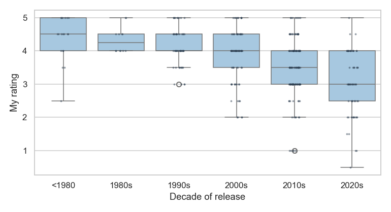
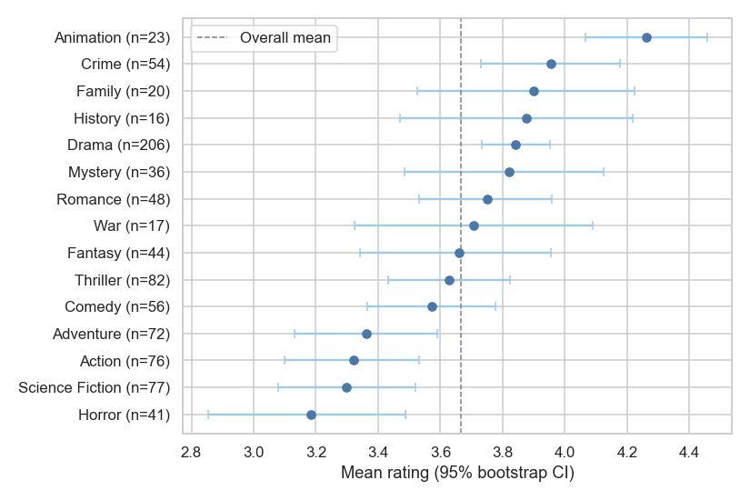
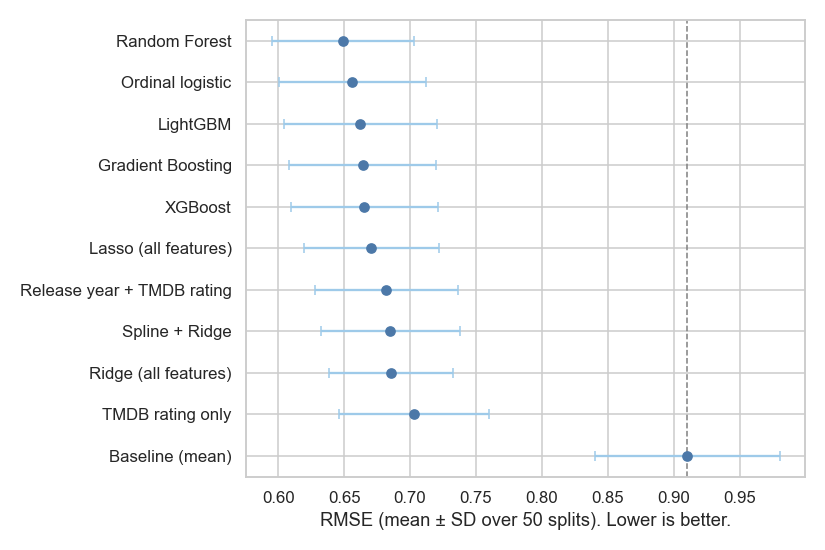
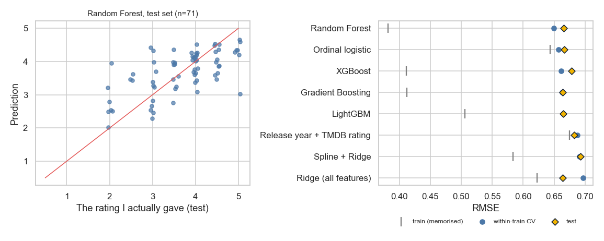

# What my Letterboxd ratings say about my taste

**Live page: [kutaykabak.github.io/letterboxd-film-taste](https://kutaykabak.github.io/letterboxd-film-taste/)**

*[Türkçe sürüm için README.tr.md](README.tr.md)*

A data science and machine learning project built on my own Letterboxd data. I joined the 355 films I have rated with metadata from the TMDB API and asked two questions:

1. Which genres, decades and languages do I rate higher, and has my taste changed over time?
2. Can I predict the rating I would give a film I haven't seen yet?

The dataset is small, so most of the work went into not overstating the results: non-parametric tests, multiple-comparison corrections, repeated and nested cross-validation, and a held-out test set.

## Results at a glance

- Two things explain my ratings best: the film's **TMDB rating** and its **age**. I rate older films consistently higher (Spearman ρ = -0.48 between release year and my rating).
- With nested cross-validation, which also accounts for choosing the model, the prediction error is **RMSE 0.66**. A baseline that predicts my average rating for every film gets 0.91.
- On a classic 80/20 split, the chosen model scores **RMSE 0.666** on 71 held-out films (bootstrap 95% CI 0.54 to 0.79), close to the cross-validation estimate.
- Random Forest, XGBoost, LightGBM and ordinal logistic regression end up very close to each other. After a multiple-comparison correction, none of them beats a two-variable linear model (release year + TMDB rating) by a significant margin.
- A four-variable **ordinal logistic regression** gets nearly the same error as Random Forest and can be interpreted: one standard deviation more TMDB rating multiplies the odds of me giving a higher rating by 5.1.
- Separating films I loved (4+ stars) from the rest: ROC AUC 0.83 to 0.84.

## Data

| Source | Contents |
|---|---|
| Letterboxd export | 358 rated films, 479 watched films, a 249-film watchlist, 77 liked films |
| TMDB API | Genres, runtime, language, country, director, cast, TMDB average rating, vote count, popularity |

700 of 727 unique films matched on TMDB. Most of the misses were TV series and episodes (Black Mirror episodes, for example), which is why 3 of my rated titles drop out and 355 films remain.

The raw Letterboxd export is personal and is not part of this repository (`.gitignore`).

## 1. Exploratory analysis and tests

Notebook: [`notebooks/letterboxd_analysis.ipynb`](notebooks/letterboxd_analysis.ipynb), Part 2

My ratings are an ordinal scale in half-star steps from 0.5 to 5, so I used Kruskal-Wallis, Mann-Whitney U and Spearman correlation instead of t-tests. I tested many genres at once, so the p-values are Benjamini-Hochberg adjusted. Confidence intervals for means come from the bootstrap.

| Finding | Result |
|---|---|
| My average rating | 3.66 (95% CI 3.57 to 3.76), median 4 |
| By decade | before 1980: 4.37, 1990s: 4.15, 2000s: 3.87, 2010s: 3.49, 2020s: 3.02 (Kruskal-Wallis p < 0.001) |
| Highest-rated genres | Animation 4.26, Crime 3.95, Drama 3.84 |
| Lowest-rated genres | Horror 3.18, Science Fiction 3.30, Action 3.32, Adventure 3.36 |
| Agreement with TMDB | Spearman ρ = 0.60 (95% CI 0.52 to 0.67) |
| English vs. other languages | 3.60 vs. 3.93 (Mann-Whitney p = 0.001) |
| Over time | Means differ by the year I rated the film, but there's no steady trend (ρ = 0.09, p = 0.10) |

Part of the older-film effect is probably selection: from older decades I mostly watch films that are already well regarded, while I pick new releases more at random.




## 2. Predicting my rating

Notebook: [`notebooks/letterboxd_analysis.ipynb`](notebooks/letterboxd_analysis.ipynb), Part 3

**Method**

- 27 features: release year, runtime, TMDB rating, log vote count, log popularity, number of genres, language flags and 19 genre flags.
- I left out the "liked" heart and anything about the rating date. For a new film they're unknown, or they're created together with the rating, so they would leak.
- Evaluation: 5-fold cross-validation repeated 10 times (50 splits). Every model sees the same splits.
- The splits aren't independent, so I compared models with the Nadeau-Bengio corrected resampled t-test and applied a Holm correction for multiple comparisons.
- Model and hyperparameter selection also ran inside nested cross-validation (outer 5x2, inner 5-fold grid search), plus a separate 80/20 hold-out test.

**Results** (mean over 50 splits)

| Model | RMSE | MAE | R² |
|---|---|---|---|
| Baseline (mean) | 0.910 | 0.738 | -0.01 |
| TMDB rating only | 0.703 | 0.553 | 0.39 |
| Release year + TMDB rating | 0.682 | 0.533 | 0.42 |
| Ridge (all features) | 0.686 | 0.525 | 0.42 |
| Spline + Ridge | 0.685 | 0.533 | 0.42 |
| Lasso (all features) | 0.671 | 0.513 | 0.44 |
| XGBoost | 0.665 | 0.519 | 0.45 |
| Gradient Boosting | 0.664 | 0.517 | 0.45 |
| LightGBM | 0.662 | 0.519 | 0.46 |
| Ordinal logistic regression (4 features) | 0.656 | 0.509 | 0.47 |
| Random Forest | 0.649 | 0.511 | 0.48 |

The standard deviation across splits is about 0.05 for every model, far larger than the gaps between the top five.

- Every model beats the baseline (corrected p < 0.001).
- Against the two-variable model, Random Forest is 0.033 and ordinal logistic 0.026 lower in RMSE. On their own those give p = 0.040 and 0.020; after the Holm correction, 0.32 and 0.18.
- Nested cross-validation: RMSE 0.662 (±0.097). On the same splits the simple model gets 0.678 and the baseline 0.908. Reporting the best model's score without accounting for selection is about 0.016 too optimistic.
- 80/20 hold-out: selection on the 284 training films picked Random Forest again. On the 71 test films it beats the baseline by 0.19 (95% CI 0.06 to 0.33); its edge over the simple model is 0.018 with an interval that includes zero.
- Random Forest is off by about half a star on films it hasn't seen. 58% of its predictions are within half a star and 89% within one star.




**Ordinal logistic regression coefficients** (standardised features, odds ratios)

| Feature (+1 SD) | Odds ratio | 95% CI | p |
|---|---|---|---|
| TMDB rating (+0.69 points) | 5.13 | 3.77 to 6.99 | < 0.001 |
| Release year (+15 years) | 0.64 | 0.51 to 0.81 | < 0.001 |
| Log vote count | 0.64 | 0.47 to 0.87 | 0.004 |
| English language | 0.85 | 0.65 to 1.11 | 0.23 |

Of two films with the same TMDB rating, I like the less-known one more. Language stops mattering once the other variables are held fixed: the language gap from the exploratory analysis seems to come from non-English films being older and better rated on TMDB.

**Loved it or not:** baseline AUC 0.50, logistic regression 0.83, XGBoost 0.84.

**Watchlist:** I fit the model on all 355 films and ranked the 247 films on my watchlist ([`reports/watchlist_predictions.csv`](reports/watchlist_predictions.csv)). Persona, The Seventh Seal, Harakiri and Wild Strawberries come out on top; Salvation, Megalopolis and Longlegs at the bottom.

## Limitations

- 355 films is not much. Intervals are wide and the differences between models are at the noise level.
- The model can't separate my taste from the TMDB average and the film's age. Films the crowd dislikes but I enjoy will keep being predicted wrong.
- I didn't use director, cast or keyword information; most directors appear only once. Turning these into text embeddings is a possible next step.
- Most films I have rated are well known, so predictions are less reliable for obscure films.

## Ways to explore the results

- **Interactive page** ([live](https://kutaykabak.github.io/letterboxd-film-taste/), source in [`site/`](site/)): a single-page data story with a searchable chart of all 355 films, built with plain SVG and JavaScript. English at the root, Turkish under [`/tr/`](https://kutaykabak.github.io/letterboxd-film-taste/tr/). Deployed to GitHub Pages by a GitHub Actions workflow on every push.
- **Streamlit dashboard** ([`app/streamlit_app.py`](app/streamlit_app.py)): taste charts, a "predict my rating" form and a filterable watchlist.
- **Power BI report** ([`powerbi/letterboxd_en.pbix`](powerbi/letterboxd_en.pbix)): a star-schema model (films, a film–genre bridge table, genres, watchlist, model results), DAX measures and three pages (Overview, Me vs. the crowd, Model and watchlist) with language and genre slicers. The same report is also stored in Power BI project format under [`powerbi/en/`](powerbi/en/) (TMDL model, JSON visuals), so changes show up line by line in git.

## Project structure

| Path | Contents |
|---|---|
| `notebooks/letterboxd_analysis.ipynb` | Full analysis in English, runs top to bottom |
| `notebooks/letterboxd_analizi.ipynb` | The same analysis in Turkish |
| `notebooks/01_temizlik.ipynb`, `02_eda_testler.ipynb`, `03_modelleme.ipynb` | The Turkish analysis split into three parts |
| `src/tmdb_enrich.py` | Matches Letterboxd films to TMDB and pulls metadata |
| `src/features.py` | Shared feature building for the model and the dashboard |
| `src/build_site.py` | Builds `site/data.js` from the processed data |
| `src/export_powerbi.py` | Writes the star-schema tables for Power BI to `data/powerbi/` |
| `app/streamlit_app.py` | Streamlit dashboard |
| `site/` | Static interactive page |
| `powerbi/` | Power BI reports (Turkish and English), Power Query code, colour theme |
| `reports/` | Figures (`figures_en/` in English) and watchlist predictions |

## How to run

Tested with Python 3.14.

```powershell
py -m pip install -r requirements.txt
```

1. Get a free TMDB API key and put it in a `.env` file in the project root: `TMDB_API_KEY=...`
2. Copy `ratings.csv`, `watched.csv`, `watchlist.csv`, `diary.csv` and `reviews.csv` from your Letterboxd export into `data/raw/`, and `likes/films.csv` as `data/raw/likes_films.csv`.
3. Pull the TMDB data: `py src\tmdb_enrich.py`
4. Run the notebook: `py -m jupyter lab`, then `notebooks/letterboxd_analysis.ipynb`.
5. Dashboard: `py -m streamlit run app\streamlit_app.py`
6. Static page: `py src\build_site.py`, then `py -m http.server 8600 --directory site` and open `http://localhost:8600`.
7. Power BI: `py src\export_powerbi.py`, then open `powerbi/letterboxd_en.pbix`. If your data folder is somewhere else, change the `Folder` value in the queries ([`powerbi/queries.pq`](powerbi/queries.pq)).

## Tools

Python (pandas, scikit-learn, statsmodels, XGBoost, LightGBM, matplotlib, seaborn), Jupyter, Streamlit, Power BI (Power Query, DAX), HTML/CSS/JavaScript.

This product uses the TMDB API but is not endorsed or certified by TMDB.
