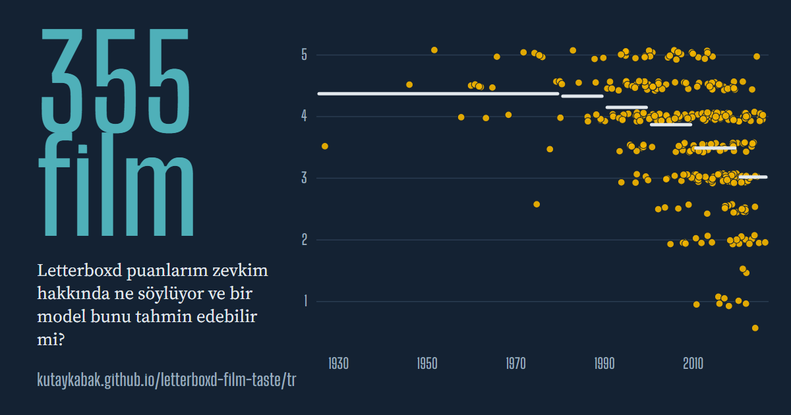
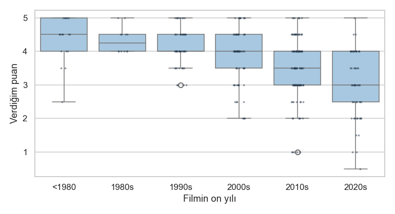
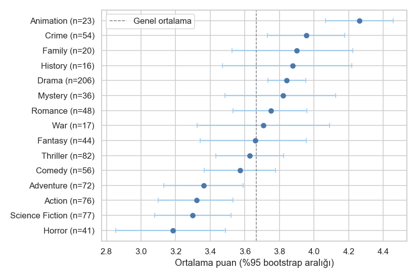
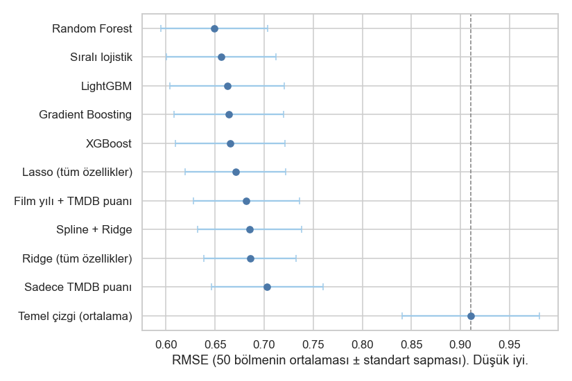
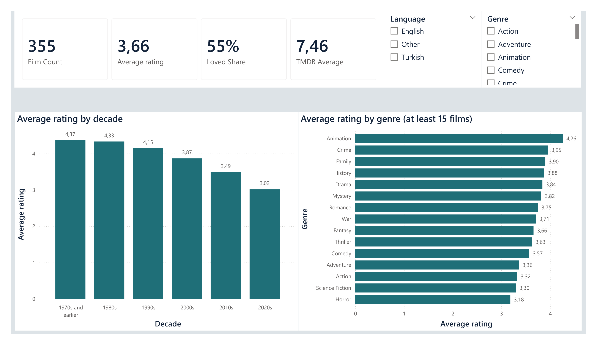
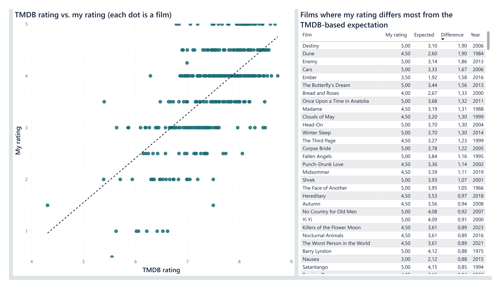
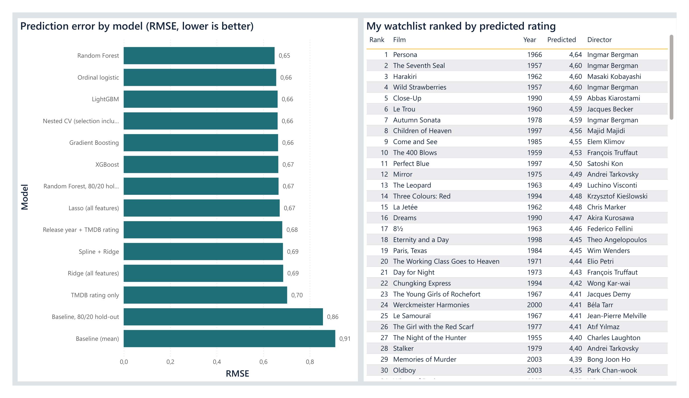

# Letterboxd film zevki: analiz ve puan tahmini

[](https://kutaykabak.github.io/letterboxd-film-taste/tr/)

**Canlı sayfa: [kutaykabak.github.io/letterboxd-film-taste/tr](https://kutaykabak.github.io/letterboxd-film-taste/tr/)** (İngilizcesi: [ana sayfa](https://kutaykabak.github.io/letterboxd-film-taste/))

*[English version: README.md](README.md)*

Kendi Letterboxd verimle yaptığım bir veri bilimi ve makine öğrenmesi projesi. 355 filme verdiğim puanları TMDB'den çektiğim film bilgileriyle birleştirdim ve iki soruya baktım:

1. Hangi tür, dönem ve dillerdeki filmlere daha yüksek puan veriyorum? Zevkim zamanla değişti mi?
2. Hiç izlemediğim bir filme kaç puan vereceğimi tahmin edebilir miyim?

Veri küçük olduğu için bu projede en çok uğraştığım şey, sonuçları olduğundan iyi göstermemekti: parametrik olmayan testler, çoklu karşılaştırma düzeltmesi, tekrarlı ve iç içe çapraz doğrulama.

## Kısaca sonuçlar

- Puanlarımı en iyi açıklayan iki şey filmin **TMDB puanı** ve **yaşı**. Eski filmlere sistematik olarak daha yüksek puan veriyorum (film yılı ile puan arasında Spearman ρ = -0,48).
- Model seçimini de hesaba katan iç içe çapraz doğrulamayla tahmin hatası **RMSE 0,66**. Herkese ortalamamı söyleyen temel çizginin hatası 0,91.
- Random Forest, XGBoost, LightGBM ve sıralı lojistik regresyon birbirine çok yakın sonuç verdi. Hiçbiri "film yılı + TMDB puanı" ile kurulan iki değişkenli doğrusal modeli, çoklu karşılaştırma düzeltmesinden sonra anlamlı biçimde geçemedi.
- Sadece dört değişkenli **sıralı lojistik regresyon**, Random Forest'la neredeyse aynı hatayı verdi ve yorumlanabiliyor: TMDB puanı 1 standart sapma artınca daha yüksek puan verme odds'um 5,1 katına çıkıyor.
- "Sevdim" (4 ve üstü) ile "sevmedim"i ayırmada ROC AUC 0,83 ile 0,84 arası.

## Veri

| Kaynak | İçerik |
|---|---|
| Letterboxd dışa aktarımı | 358 puanlı film, 479 izlenen film, 249 filmlik izleme listesi, 77 kalp |
| TMDB API | Tür, süre, dil, ülke, yönetmen, oyuncu, TMDB ortalama puanı, oy sayısı, popülerlik |

727 benzersiz filmden 700'ü TMDB ile eşleşti. Eşleşmeyenlerin çoğu dizi ve bölümdü (Black Mirror bölümleri gibi). Puanladıklarımdan 3'ü bu yüzden analiz dışında kaldı, geriye 355 film kaldı.

Ham Letterboxd verisi kişisel olduğu için depoya eklenmiyor (`.gitignore`).

## 1. Keşifsel analiz ve testler

[`notebooks/02_eda_testler.ipynb`](notebooks/02_eda_testler.ipynb)

Puanlarım 0,5 ile 5 arasında yarım yarım artan sıralı bir ölçek. O yüzden t testi yerine Kruskal-Wallis, Mann-Whitney U ve Spearman korelasyonu kullandım. Birçok türü aynı anda test ettiğim için p değerlerini Benjamini-Hochberg ile düzelttim. Ortalamalar için güven aralıklarını bootstrap ile hesapladım.

| Bulgu | Sonuç |
|---|---|
| Ortalama puanım | 3,66 (%95 aralık 3,57 ile 3,76), ortanca 4 |
| On yıllara göre | 1980 öncesi 4,37, 1990'lar 4,15, 2000'ler 3,87, 2010'lar 3,49, 2020'ler 3,02 (Kruskal-Wallis p < 0,001) |
| Yüksek puanlı türler | Animation 4,26, Crime 3,95, Drama 3,84 |
| Düşük puanlı türler | Horror 3,18, Science Fiction 3,30, Action 3,32, Adventure 3,36 |
| TMDB puanıyla ilişki | Spearman ρ = 0,60 (%95 aralık 0,52 ile 0,67) |
| İngilizce ve diğer diller | 3,60 ve 3,93 (Mann-Whitney p = 0,001) |
| Zaman içinde | Puanlama yılına göre fark var ama düzenli bir yükseliş ya da düşüş yok (ρ = 0,09, p = 0,10) |

Eski filmlere verdiğim yüksek puanların bir kısmı muhtemelen seçilim: eski filmlerden zaten övülenleri seçip izliyorum, yeni filmleri ise daha rastgele açıyorum.




## 2. Puan tahmini

[`notebooks/03_modelleme.ipynb`](notebooks/03_modelleme.ipynb)

**Yöntem**

- 27 özellik: film yılı, süre, TMDB puanı, log oy sayısı, log popülerlik, tür sayısı, dil göstergeleri ve 19 tür göstergesi.
- Kalp ve puanlama tarihi gibi bilgileri kullanmadım. Yeni bir film için bilinmiyorlar ya da puanla birlikte oluşuyorlar, yani sızıntı yaratırlar.
- Değerlendirme: 5 katlı çapraz doğrulama, 10 tekrar (50 bölme). Tüm modeller aynı bölmeleri gördü.
- Bölmeler birbirinden bağımsız olmadığı için modelleri Nadeau-Bengio düzeltmeli tekrarlı örnekleme t testiyle karşılaştırdım, çoklu karşılaştırma için Holm düzeltmesi yaptım.
- Model ve hiperparametre seçimini ayrıca iç içe çapraz doğrulamayla (dış 5x2, iç 5 katlı ızgara araması) yaptım.

**Sonuçlar**

| Model | RMSE | MAE | R² |
|---|---|---|---|
| Temel çizgi (ortalama) | 0,910 | 0,738 | -0,01 |
| Sadece TMDB puanı | 0,703 | 0,553 | 0,39 |
| Film yılı + TMDB puanı | 0,682 | 0,533 | 0,42 |
| Ridge (tüm özellikler) | 0,686 | 0,525 | 0,42 |
| Spline + Ridge | 0,685 | 0,533 | 0,42 |
| Lasso (tüm özellikler) | 0,671 | 0,513 | 0,44 |
| XGBoost | 0,665 | 0,519 | 0,45 |
| Gradient Boosting | 0,664 | 0,517 | 0,45 |
| LightGBM | 0,662 | 0,519 | 0,46 |
| Sıralı lojistik regresyon (4 özellik) | 0,656 | 0,509 | 0,47 |
| Random Forest | 0,649 | 0,511 | 0,48 |

Her modelin bölmeler arası standart sapması yaklaşık 0,05. İlk beş model arasındaki farklar bunun çok altında.

- Tüm modeller temel çizgiden anlamlı derecede iyi (düzeltilmiş p < 0,001).
- İki değişkenli basit modele göre Random Forest 0,033, sıralı lojistik 0,026 daha düşük RMSE verdi. Tek başına bakınca p = 0,040 ve 0,020, Holm düzeltmesinden sonra 0,32 ve 0,18.
- İç içe çapraz doğrulama: RMSE 0,662 (±0,097). Aynı bölmelerde basit model 0,678, temel çizgi 0,908. Seçim yapmadan "en iyi" skoru raporlamak yaklaşık 0,016 iyimser.
- Klasik 80/20 ayrımı: model seçimi sadece 284 eğitim filmiyle yapıldı (yine Random Forest). En baştan ayrılan 71 test filminde RMSE 0,666 (bootstrap %95 aralığı 0,54 ile 0,79). Temel çizgiden 0,19 daha iyi (aralık 0,06 ile 0,33), basit modelden farkı ise 0,018 ve aralığı sıfırı içeriyor. Test hatası çapraz doğrulama tahminine çok yakın.
- Random Forest görmediği filmlerde ortalama 0,5 puan yanılıyor. Tahminlerin %58'i yarım puan, %89'u bir puan içinde.



**Sıralı lojistik regresyonun katsayıları** (özellikler standartlaştırılmış, odds oranları)

| Özellik (1 standart sapma) | Odds oranı | %95 aralık | p |
|---|---|---|---|
| TMDB puanı (+0,69 puan) | 5,13 | 3,77 ile 6,99 | < 0,001 |
| Film yılı (+15 yıl) | 0,64 | 0,51 ile 0,81 | < 0,001 |
| Log oy sayısı | 0,64 | 0,47 ile 0,87 | 0,004 |
| İngilizce | 0,85 | 0,65 ile 1,11 | 0,23 |

Aynı TMDB puanına sahip iki filmden daha az bilinenini daha çok seviyorum. Dil ise diğer değişkenler sabit tutulunca bir şey anlatmıyor. EDA'daki yabancı dil farkı, bu filmlerin daha eski ve TMDB'de daha yüksek puanlı olmasından geliyor gibi.

**Sevdim / sevmedim sınıflandırması:** temel çizgi AUC 0,50, lojistik regresyon 0,83, XGBoost 0,84.

**İzleme listesi:** modeli tüm verilerle eğitip izleme listemdeki 247 filme uyguladım ([`reports/izleme_listesi_tahminleri.csv`](reports/izleme_listesi_tahminleri.csv)). En üstte Persona, The Seventh Seal, Harakiri ve Wild Strawberries var, en altta Salvation, Megalopolis ve Longlegs.

## Sınırlar

- 355 film az. Aralıklar geniş ve modeller arasındaki farklar gürültü seviyesinde.
- Model, benim zevkimi TMDB ortalamasından ve filmin yaşından ayıramıyor. Kalabalığın sevmediği ama benim sevdiğim filmlerde hep yanılacak.
- Yönetmen, oyuncu ve anahtar kelime bilgilerini kullanmadım. Yönetmenlerin çoğu veride bir kez geçiyor. Bunları metin vektörlerine çevirmek bir sonraki adım olabilir.
- Puanladığım filmlerin çoğu tanınmış filmler. Az bilinen filmlerde tahmin daha az güvenilir.

## Proje yapısı

| Yol | İçerik |
|---|---|
| `src/tmdb_enrich.py` | Letterboxd filmlerini TMDB ile eşleştirip zenginleştiriyor |
| `notebooks/letterboxd_analizi.ipynb` | Aşağıdaki üç not defterinin tek dosyada birleşmiş hali, baştan sona çalıştırılabilir |
| `notebooks/letterboxd_analysis.ipynb` | Birleşik not defterinin İngilizce sürümü (açıklamalar, grafikler ve çıktılar İngilizce; grafikler `reports/figures_en/` altına) |
| `notebooks/01_temizlik.ipynb` | Birleştirme, öznitelikler, analiz tablosu |
| `notebooks/02_eda_testler.ipynb` | Keşifsel analiz ve istatistiksel testler |
| `notebooks/03_modelleme.ipynb` | Tahmin modelleri, iç içe çapraz doğrulama, izleme listesi |
| `site/index.html` | Statik tek sayfalık site: bulguları anlatan etkileşimli bir veri yazısı (`site/data.js` verisiyle) |
| `src/build_site.py` | `site/data.js` ve `site/catalog.js` dosyalarını üretiyor (katalog: 5.000 film için modelin tahmini) |
| `src/fetch_catalog.py` | TMDB'de en çok oy almış 5.000 filmi çekiyor; sitedeki "Herhangi bir film için tahmin" kutusu bunu kullanıyor |
| `app/streamlit_app.py` | Etkileşimli pano: zevk grafikleri, puan tahmini, izleme listesi sıralaması |
| `src/export_powerbi.py` | Power BI için yıldız şema tablolarını `data/powerbi/` altına yazıyor |
| `src/features.py` | Pano ve model için ortak özellik üretimi |
| `reports/figures/` | Grafikler |
| `reports/share/` | LinkedIn görselleri, kaydırmalı PDF ve paylaşım metinleri (`share.html` ve `render_share.ps1` ile üretiliyor) |
| `data/processed/` | TMDB ile zenginleştirilmiş veri |

## Çalıştırma

Python 3.14 ile denendi.

```powershell
py -m pip install -r requirements.txt
```

1. TMDB'den ücretsiz bir API anahtarı al ve proje köküne `.env` dosyası olarak yaz: `TMDB_API_KEY=...`
2. Letterboxd dışa aktarımındaki `ratings.csv`, `watched.csv`, `watchlist.csv`, `diary.csv` ve `reviews.csv` dosyalarını `data/raw/` altına koy. `likes/films.csv` dosyasını da `data/raw/likes_films.csv` adıyla ekle.
3. `py src\tmdb_enrich.py` ile TMDB verisini çek.
4. `py -m jupyter lab` ile not defterlerini sırayla çalıştır.
5. Panoyu açmak için: `py -m streamlit run app\streamlit_app.py`
6. Statik site için: `py src\build_site.py`, ardından `py -m http.server 8600 --directory site` ve tarayıcıda `http://localhost:8600`. Site sunucu gerektirmediği için GitHub Pages'te de yayınlanabilir.

## Power BI

`py src\export_powerbi.py` komutu Power BI için beş tabloyu `data/powerbi/` altına yazar:

| Tablo | Satır | Rolü |
|---|---|---|
| `films.csv` | 355 | Olgu tablosu. Her puanladığım film bir satır: puan, TMDB bilgileri, dil grubu, yönetmen, TMDB'den beklenen puan, modelin filmi görmeden yaptığı tahmin ve hatası |
| `film_genres.csv` | 882 | Köprü tablo: `film_id`, `genre`. Bir filmin birden fazla türü olabildiği için ayrı |
| `genres.csv` | 19 | Tür boyutu: İngilizce ve Türkçe ad |
| `watchlist.csv` | 247 | İzleme listesi, modelin tahminine göre sıralı |
| `model_results.csv` | 14 | Modellerin RMSE, MAE ve R² değerleri; iç içe CV ve 80/20 testi dahil |

Hazır rapor: [`powerbi/letterboxd.pbix`](powerbi/letterboxd.pbix). Üç sayfası var:

- **Genel bakış:** film sayısı, ortalama puan, sevdim oranı ve TMDB ortalaması kartları; on yıllara göre ve türlere göre (en az 15 film) ortalama puan.
- **Ben ve kalabalık:** TMDB puanı ile benim puanımın dağılım grafiği (eğilim çizgisiyle) ve TMDB'ye göre beklenenden en çok ayrıldığım filmler.
- **Model ve izleme listesi:** 11 modelin ve iki doğrulama yönteminin RMSE karşılaştırması, izleme listemin tahmine göre sıralaması.

İngilizce sürüm: [`powerbi/letterboxd_en.pbix`](powerbi/letterboxd_en.pbix). Sayfa adları (Overview, Me vs. the crowd, Model and watchlist), başlıklar, ölçüler (Average Rating, Film Count, Loved Share…), eksenler, dilimleyiciler, tür ve on yıl etiketleri İngilizce. Aynı rapor metin dosyaları olarak da `powerbi/en/letterboxd_en.pbip` altında duruyor (Power BI proje biçimi: model TMDL, görseller JSON), böylece değişiklikler git'te satır satır görülebilir. Renk teması `powerbi/tema.json`.

İngilizce raporun sayfaları ([PDF olarak](reports/powerbi/letterboxd_en.pdf)):





Power Query sorguları [`powerbi/queries.pq`](powerbi/queries.pq) dosyasında. Sayılar `en-US` kültürüyle okunduğu için Türkçe Windows'ta ondalık sorunu çıkmıyor. Klasör yolu farklıysa sorgulardaki `Folder` değerini değiştirmek yeterli.

**Power BI Desktop'ta sıfırdan kurulum**

1. *Veri al → Metin/CSV* ile beş dosyayı yükle. Ondalıklar nokta ile yazıldı. Bilgisayarın Türkçe ayarlıysa Power Query'de sayı sütunlarının türünü *Değiştir → Yerel ayarı kullanarak → İngilizce (ABD)* ile ayarla, yoksa 4.5 sayısı 45 olarak okunur.
2. İlişkiler: `films[film_id]` 1 → * `film_genres[film_id]`, `genres[genre]` 1 → * `film_genres[genre]`. Türe göre filtrelemenin filmlere geçmesi için `films`–`film_genres` ilişkisinde çapraz filtre yönünü *İkisi de* yap.
3. Tarih tablosu için DAX: `Date = CALENDAR(DATE(2022,12,1), DATE(2026,12,31))` ve `films[rated_date]` ile ilişkilendir.

**Örnek DAX ölçüleri**

```
Ortalama Puan = AVERAGE(films[rating])
Film Sayısı = COUNTROWS(films)
Ortalamadan Fark = [Ortalama Puan] - CALCULATE([Ortalama Puan], ALL(genres), ALL(film_genres))
Sevdim Oranı = DIVIDE(CALCULATE([Film Sayısı], films[loved] = 1), [Film Sayısı])
Model Hatası (MAE) = AVERAGE(films[abs_error])
```

**Rapor sayfaları için öneri:** genel bakış (kartlar, puan dağılımı, dilimleyiciler), zevkim (türler, on yıllar, ülkeler), ben ve kalabalık (`tmdb_rating` ile `rating` dağılım grafiği, `diff_from_crowd`'a göre en çok ayrıldığım filmler), model (`model_results`, `predicted_rating` ile `rating`, türlere göre `abs_error`) ve izleme listesi.

`data/powerbi/` kişisel puanlarımı içeriyor. Raporu *Publish to web* ile yayınlamak bu veriyi herkese açar.

## Pano

Streamlit panosunda dört sekme var. **Zevkim** sekmesinde puan dağılımı, on yıl ve tür grafikleri, TMDB ile karşılaştırma ve aranabilir film tablosu var. **Tahmin et** sekmesinde listeden bir film seçip ya da yıl, TMDB puanı, tür gibi bilgileri girip tahmini puanımı görebiliyorsun. **İzleme listesi** sekmesi listemi tahmine göre sıralıyor ve türe, yıla göre süzüyor. **Model** sekmesinde model karşılaştırma grafikleri duruyor.

## Lisans

Kod [MIT lisansıyla](LICENSE) paylaşılıyor. Puanlar bana ait, film bilgileri TMDB'den.

Bu ürün TMDB API'sini kullanır ancak TMDB tarafından onaylanmamıştır.
